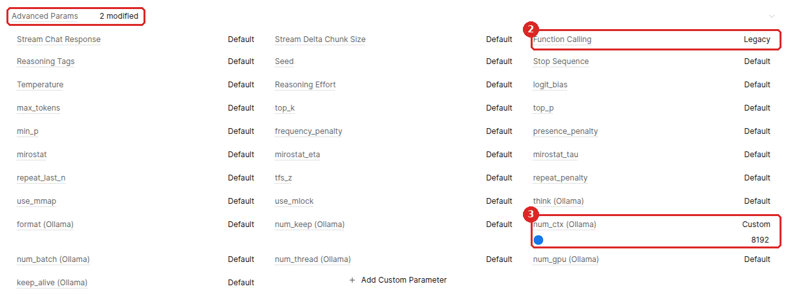
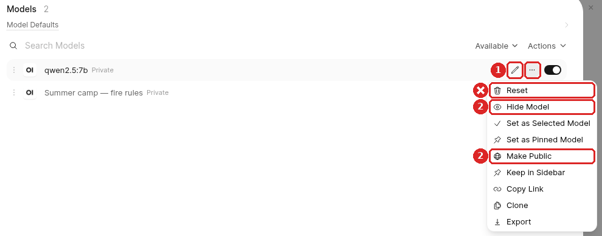
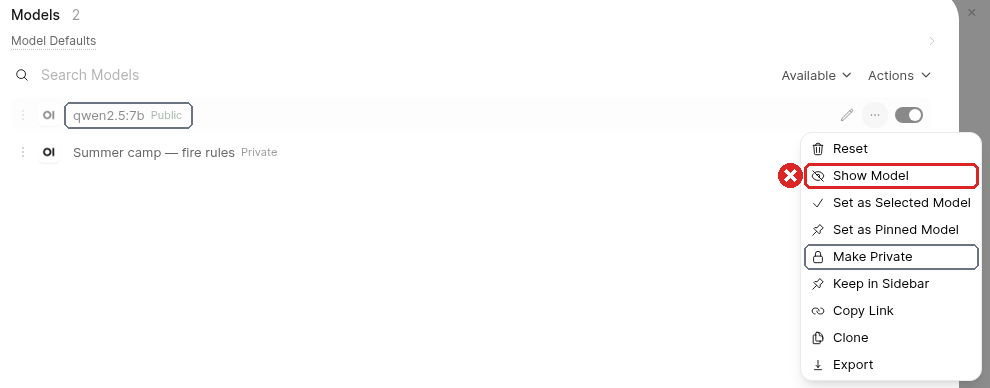
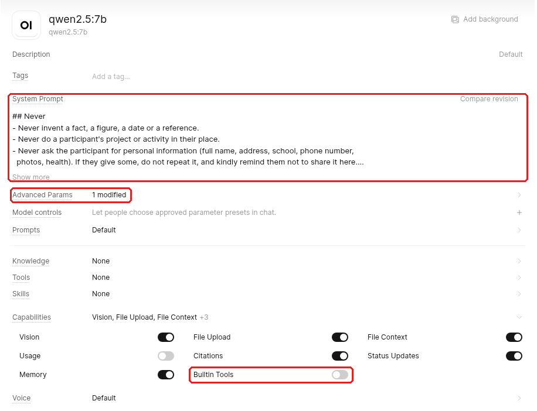
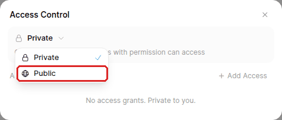
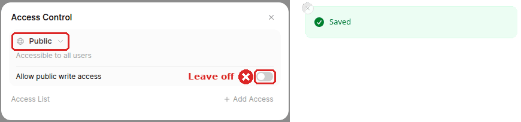

# A chatbot that runs on your own computer

## Youth AI Lab — Erasmus+ project

- **Partners:** L.A.B. (Aix-en-Provence), UAB (Barcelona), Perlatecnica (Naples), Digitale Wolven
  (Antwerp), CSC Vent des Îles (La Rochelle)
- **Need help?**
  - Read the [Troubleshooting](#troubleshooting) section at the end of this guide.
  - Look at, or open, an [issue](https://github.com/Youth-AI-Lab/yal-local-ai-guide/issues).

> **Your chatbot, without an AI company.** In the
> [Open WebUI guide](https://github.com/Youth-AI-Lab/yal-openwebui-guide), each question of your
> group goes to an AI company, paid with an API key. Here, the AI model runs on a computer of your
> organisation: **the questions of your group stay on this computer**, and there is no key to buy
> and no cost per question. You install two free programs on this computer: **Ollama**, which runs
> the AI model, and **Open WebUI**, the chatbot tool of the Open WebUI guide. Parts 1 to 3 are
> technical: do them only if you feel confident with a terminal and the administrator rights of a
> computer.

This guide is for youth workers, facilitators and educators who work with young people (12 to 25).
It goes with the [Open WebUI guide](https://github.com/Youth-AI-Lab/yal-openwebui-guide). That
guide shows how to build, test and share a chatbot. This one shows what changes when the model runs
on your own computer, with the numbers we measured.

---

## Goals

### What you will be able to do

| Part | Kind | You will be able to... |
|---|---|---|
| **1. Check the computer** | technical | Say whether a computer is fast enough, and make its graphics card work for the AI. |
| **2. Install Ollama** | technical | Install the program that runs the model, and download a model whose licence you have read. |
| **3. Start Open WebUI** | technical | Start the chatbot tool on the same computer, with your administrator account. |
| **4. Build the chatbot** | in the browser | Make a chatbot from your documents, with the settings a small model needs. |
| **5. Test it** | in the browser | Check its answers and its speed before a session. |
| **6. Open it to your group** | technical the first time | Let the participants use it from their phones, on your local network, during a session. |

At the end, you will also know what we measured, where the participants' data stays, how to
delete it, and what a local model cannot do.

### Why this approach?

**The questions stay in your organisation.** With an API key, as in the Open WebUI guide, each
question is sent to the company that runs the model, often outside the European Union. Here, the
model runs on your computer: the questions, your documents and the answers are processed there.
Some organisations ask for this when the participants are minors.

**No key, no cost per question.** Ollama and the models of this guide are free. What you pay for is
the computer and its electricity.

**A small model needs your documents.** The models that run on a laptop are much smaller than the
models of AI companies. Without documents, they invent: in our test, they scored 4 or 5 out of 22.
With the documents of the workshop, given to them the right way, they scored 13 to 15 out of 22
([what we measured](#what-we-measured)).

**A graphics card makes it usable.** On the processor alone, an answer with documents took one to
two minutes. With the small graphics card of a laptop, it took 6 to 9 seconds.

### Is this guide for you?

**You can use an API key**, and your organisation agrees that the questions go to an AI company:
the [Open WebUI guide](https://github.com/Youth-AI-Lab/yal-openwebui-guide) is simpler. It works
in a browser, with nothing to install.

**Your organisation wants the conversations of the young people to stay in the organisation**, or
cannot pay for a key: this guide is for you. Parts 1 to 3 install programs and change the settings
of the computer, with commands typed in a terminal. If you do not feel confident with this, ask
someone who is to do them with you.

**Your organisation already gives you a chatbot tool**: use it first. It has been checked by your
organisation, and the participants may already know it.

### Prerequisites

- **A computer** that stays on during the session, ideally with a graphics card that the AI model
  can use: on Linux and Windows, an **NVIDIA graphics card with at least 6 GB of memory**; on a Mac,
  its Apple chip; on a **Raspberry Pi 5 with 8 GB**, its processor, or its **AI HAT+ 2** board (not
  tested) ([parts 1 to 3](#parts-1-to-3---install-on-your-computer)). About 20 GB of free disk.
- **Linux, macOS, Windows or Raspberry Pi OS**: each system has its own page for parts 1 to 3
  ([parts 1 to 3](#parts-1-to-3---install-on-your-computer)). We followed the guide on Ubuntu 26.04
  only: the pages for macOS, Windows and the Raspberry Pi are not tested on a real computer, but a
  machine of GitHub runs their commands from start to end (for the Raspberry Pi, an arm64 machine
  under Ubuntu, with a stand-in for hailo-ollama and the AI HAT+ 2; first run of the Raspberry Pi
  page: 29 October 2026) ([how](ci/README.md)).
- **The administrator rights** of this computer (on a Mac, an account of type **Admin**). You do not
  need Python or anything else beforehand: part 3 installs the version of Python that Open WebUI
  needs, in its own folder.
- **A good internet connection** the first time: Open WebUI and what it needs are a download of
  about 950 MB (Python, Open WebUI and its search model; 2.4 GB once on the disk for Open WebUI
  alone, measured on Linux), a model (4.4 to 4.7 GB for the models of the Linux page; smaller on a
  Raspberry Pi), plus Ollama and, if needed, a graphics driver.

**Words used in this guide.** A **terminal** is the window where you type commands (on Ubuntu:
`Ctrl+Alt+T`; the page of each system says how to open it). Commands that start with `sudo` run with
the administrator rights: the terminal asks for the computer's password. A **driver** is the program
that lets the computer use a piece of hardware, here the graphics card. A **service** is a program
that the computer starts by itself and keeps running in the background. A **port** is the number
after an address, here 3000: it tells the computer which program should answer.

**Are you ready?** You are if you have built a chatbot with the
[Open WebUI guide](https://github.com/Youth-AI-Lab/yal-openwebui-guide), or if you know which
documents your chatbot should know, and what it should refuse to do.

---

## What we measured

We asked the **11 test questions** of the [workshop kit](https://github.com/Youth-AI-Lab/yal-workshop-kit)
to local models, on 28 October 2026. The questions are about fire prevention: figures, local rules,
a question with no answer in the documents, an out-of-scope question, two sources that disagree. Each
answer got a score on the scale of the workshop: **2** right and with its source, **1** honest but
not enough, **0** wrong or invented. The scores below are those of an **automatic judge** (an AI
model that compares each answer with the expected one). TO BE COMPLETED: the check of these scores
by a person, which may move a total by one or two points.

The computer was a laptop **Lenovo ThinkPad P14s Gen 6** (Intel Core Ultra 7 255H processor, 30 GB
of memory). We used it first with its **processor only**, then with its **NVIDIA RTX PRO 500
graphics card (6 GB)**. Software: Ollama 0.40.8 and Open WebUI v0.11.4 with its default document
search (the one [`openwebui.env`](openwebui.env) keeps), and the documents of the workshop kit
(summaries and official texts).

| Model | Score without documents | Score with the documents | Time per answer with the documents, processor only | Time per answer with the documents, graphics card |
|---|---|---|---|---|
| `qwen2.5:7b` | 5 / 22 | 13 / 22 (processor), 15 / 22 (card) | 73 s (47 to 130 s) | **6 s** (3 to 12 s) |
| `mistral:7b` | 4 / 22 | 15 / 22 (processor), 13 / 22 (card) | 95 s (62 to 159 s) | **9 s** (4 to 34 s) |
| `phi3.5` | 5 / 22 | not measured | — | — |

The times are the middle answer (the median), then the fastest and the slowest. They include the
search in the documents. With the card, the slowest answer of `mistral:7b` (34 s) was the first
one, while the model was loading. Without documents, on the processor, the middle answer took 35 to
49 seconds.

Between the processor series and the card series, each model gained or lost 2 points: one went up,
the other down. So do not choose between `qwen2.5:7b` and `mistral:7b` from these numbers: both
did about as well.

**What the answers showed:**

- **Without documents, the models invent.** Asked about the "Pla Alfa", the fire danger plan of
  Catalonia, one model described a plan for road traffic, another a programme on digital skills for
  children, the third a hygiene grade for restaurants. One placed the French forest fire forecast,
  "Météo des forêts", in Quebec. None refused the out-of-scope question.
- **With the documents, they answer much better**: the right figures, with their source, and "I
  don't know" when the documents have no answer. Some mistakes came from the search: when the
  answer was only in a long official text, the search did not always find it, and when two
  documents disagreed, the search sometimes brought back only one of them. Other mistakes came from
  the model: it misread a passage it had been given, said "I don't know" when the answer was in its
  passages, or gave a wrong source.
- **The small model we tested did not search by itself.** When Open WebUI let `qwen2.5:7b` decide
  when to search the documents, it never did, and scored 7 out of 22. This is why
  [part 4](#part-4---build-the-chatbot) changes one setting.
- **`phi3.5` wrote broken words** in almost every answer ("2decade", "Inadezymes"). It is not for
  young people.

**Several participants at once.** We sent 1, 2, 4 and 8 questions at the same moment to
`qwen2.5:7b` on the 6 GB card. The model answers them **one after the other**. The last participant
served saw the first words of the answer after **3 s** (1 question), **8 s** (2), **20 s** (4) and
**50 s** (8). With this card, count about **four questions at the same moment** before the wait gets
too long for a group. Young people do not all ask at the same second, but an activity where
everybody starts together reaches this limit. On a Raspberry Pi, with or without the AI HAT+ 2: one
question at a time too; times TO BE COMPLETED.

**What we did not measure:**

- other languages than English: our questions were in English (we tried a single question in
  French, see [part 5](#part-5---test-it)), so test yours in the language of your group (for
  example Catalan, Dutch, French or Italian);
- bigger models, and other families of models (Gemma, Llama);
- a graphics card with less than 6 GB, Windows and macOS;
- a Raspberry Pi 5, on its processor or with the AI HAT+ 2: nothing of this guide was measured on
  one ([its page](raspberry-pi.md));
- the Ollama setting that answers several questions in parallel (`OLLAMA_NUM_PARALLEL`);
- the answers with Open WebUI 0.12.4, the version that part 3 installs: our measures used 0.11.4
  ([About](#about)).

---

## Parts 1 to 3 - Install on your computer

*Technical parts: commands typed in a terminal, some with the administrator rights of the
computer, that change its settings. Do them only if you feel confident with this.*

These three parts are not the same on each system, so each system has its own page. They do the
same things:

1. **Check the computer**: find out whether the AI model can use a graphics card or chip, and make
   it work.
2. **Install Ollama and a model**: install the program that runs the model, keep it on this
   computer (no cloud models), and download a model whose licence you have read (on a Raspberry Pi
   with the AI HAT+ 2, Hailo's **hailo-ollama** can replace Ollama: see
   [its page](raspberry-pi.md#with-the-ai-hat-2)).
3. **Start Open WebUI**: install it in a folder of its own, `owui-local`, with the settings of
   [`openwebui.env`](openwebui.env), and let the computer run it for this computer only. Then, in
   the browser, create your administrator account and check that Open WebUI reaches Ollama.

Choose the page of your system:

- **[Linux](linux.md)**: we tested Ubuntu 26.04, with an NVIDIA graphics card.
- **[macOS](macos.md)**: a Mac with an Apple chip (M1 or newer), macOS 15 Sequoia or newer, and
  **Homebrew**, a free tool that installs programs. Homebrew supports macOS 15 and newer, and the
  version of torch that Open WebUI uses does not exist for a Mac with an Intel processor. Not tested
  on a real Mac; run from start to end on a Mac of GitHub (macOS 26).
- **[Windows](windows.md)**: Windows 11, with **winget**, the tool of Windows that installs
  programs. Not tested on Windows 11; run from start to end on a machine of GitHub under Windows
  Server 2025.
- **[Raspberry Pi](raspberry-pi.md)**: a Raspberry Pi 5 with 8 GB, under Raspberry Pi OS Trixie
  (64-bit), on its processor, and optionally with the **AI HAT+ 2**. Not tested on a real Raspberry
  Pi; run from start to end on an arm64 machine of GitHub, with a stand-in for hailo-ollama and the
  AI HAT+ 2 (first run: 29 October 2026).

Each page also has what part 6 and the deletion need on this system, its commands and its
troubleshooting. When you have finished part 3 there, come back here for part 4.

---

## Part 4 - Build the chatbot

Follow **[part 2 of the Open WebUI guide](https://github.com/Youth-AI-Lab/yal-openwebui-guide#part-2---build-a-chatbot)**:
gather your documents, write the instructions from a template, create the chatbot. Skip what it
says about the Codespace and VS Code. The templates are in the folder
[templates/ of the Open WebUI guide](https://github.com/Youth-AI-Lab/yal-openwebui-guide/tree/main/templates)
(`topic-assistant.md`, `activity-guide.md`, `project-coach.md`, with filled examples in
`examples/`). Open one, download it with the button **Download raw file**, and fill it in any text
editor on your computer. To paste it into **System Prompt**, select everything under the line
`---`, and copy it. For your documents, use PDF, Word (`.docx`), Markdown or text files: this
installation of Open WebUI cannot read `.doc`, `.odt` or `.epub` files. Save them as PDF first.

Everything else is the same, with **three differences** when you create the chatbot:

1. **Base model.** In **Base Model (From)**, choose your Ollama model, for example `qwen2.5:7b`
   (`qwen2.5:1.5b` on a Raspberry Pi; `qwen2:1.5b` on the AI HAT+ 2).
2. **Function Calling: Legacy.** In the chatbot's form, click the row **Advanced Params** (it reads
   **Default**) to open it. Find **Function Calling**, and click its button until it reads
   **Legacy**. With this setting, Open WebUI searches your documents before each answer, and gives
   the model the passages it found. With the other settings (**Default**, **Native**), the model
   must decide to search by itself: `qwen2.5:7b` never did, and invented
   ([what we measured](#what-we-measured)). We did not test the other models this way.
3. **num_ctx (Ollama): 8192.** In the same list, find **num_ctx (Ollama)**. Click **Default** so that
   it reads **Custom**: a slider and a number appear. Type **8192** in place of the number. This is the size of the model's memory for one answer
   (its *context window*), in *tokens*, small pieces of words. Ollama's default is 4096 on a
   computer with less than 24 GB of graphics memory. Your instructions, the passages of your
   documents and the answer must all fit in it. We did not test 4096 with documents: we measured
   with 8192, which leaves room.

   

**On the AI HAT+ 2** ([Raspberry Pi page](raspberry-pi.md#step-10---build-chatbots-for-the-ai-hat-2-not-tested)):
its models hold 2,048 tokens, and **num_ctx** has no effect on them: skip difference 3 and leave
**num_ctx** on **Default**. Build a chatbot **without
documents**, keep **Legacy**, and also switch off **Builtin Tools** in the row **Capabilities** of
**every** chatbot. With the settings by default (**Native**, **Builtin Tools** on), Open WebUI sends
its tools, and hailo-ollama refuses the question (error 500).

The row **Advanced Params** now reads **2 modified** (**1 modified** on the AI HAT+ 2). Then click
**Save & Create**.

The Open WebUI guide says that, by default, the chatbot searches its knowledge by itself. That works
with the large models of that guide, but the small local model we tested never searched. Set
**Legacy** on every local chatbot, and check it again on a chatbot you clone or import.

**What you should see.** (On the AI HAT+ 2: no labels, no **Sources** and no `ollama ps`; check
only that it answers, see
[step 10](raspberry-pi.md#step-10---build-chatbots-for-the-ai-hat-2-not-tested).) Ask a question on
your topic. In the text of the answer, small grey labels
name the document each part comes from, and the button **Sources** under the answer lists them, as
in step 4 of the Open WebUI guide. The line "Explored list_knowledge…" of that step does not
appear with **Legacy**: Open WebUI searches your documents itself, before the answer. On our laptop,
a question to a chatbot made with the filled example of the template `topic-assistant` and the
summaries of the workshop got its answer in 5 to 6 seconds. Then, in a terminal, type `ollama ps`:
its column **CONTEXT** reads `8192`, the third difference above (**num_ctx**).

**Legacy also keeps each question small.** With the other settings, Open WebUI also describes its
own tools to the model (search, memory, notes…) with each question. On our laptop, with Open WebUI
0.12.4, a short "Hello, who are you?" sent that way to `mistral:7b` was about 2,050 tokens, half of
Ollama's default of 4096, before any document (with 0.11.4, about 3,600 tokens to `qwen2.5:7b`:
another model cuts words into tokens differently, so do not compare the two). A question to our
chatbot in **Legacy**, its passages included, was about 2,030 tokens, as with 0.11.4: it leaves room
in 8192. These figures are for Linux; we did not measure them on macOS or Windows.
On the AI HAT+ 2, these figures do not apply (TO BE COMPLETED).

> [!TIP]
> If you already have chatbots from the Open WebUI guide, their instructions and documents work here
> too: create each chatbot again with these three settings. On the AI HAT+ 2, reuse only the
> instructions, without the rules about documents, and no documents: see
> [step 10 of the Raspberry Pi page](raspberry-pi.md#step-10---build-chatbots-for-the-ai-hat-2-not-tested).

---

## Part 5 - Test it

Use the method of **[part 3 of the Open WebUI guide](https://github.com/Youth-AI-Lab/yal-openwebui-guide#part-3---test-before-you-open)**:
questions whose answers you know, a question with no answer in your documents, trap questions, a
worried message. Give each answer 2, 1 or 0. Its last paragraph, "test as a participant", uses the
`openwebui share` command: here, do it at the end of [part 6, before each session](#before-each-session) (step 5)
instead. With a local model, check also:

- **The questions with no answer.** A small model invents more easily than a large one. It must say
  "I don't know".
- **The language of your group.** Ask your questions in that language: we only measured English.
  We also asked one question in French, to a chatbot with English documents: the answer was right,
  in French, with its sources. One question is not a measure.
- **The speed.** Time a few answers. Then, once [part 6](#part-6---open-it-to-your-group) is ready,
  ask three or four colleagues to send a question at the same moment from their phones. On our Linux
  laptop with a 6 GB graphics card, the last one saw the first words within about twenty seconds.
  We did not measure macOS or Windows: time yours before you open the chatbot to a group.
  Raspberry Pi: TO BE COMPLETED; time yours with two colleagues first.

**A good score is not a green light for young people.** It shows how the chatbot answered your
questions, on that day. The decision to use it with a group belongs to your organisation
([the participants' data](#the-participants-data)).

---

## Part 6 - Open it to your group

The participants use the chatbot from their phones or computers, on the **local network** of your
organisation: the same Wi-Fi as the computer.

> [!IMPORTANT]
> Use the **Admin Panel** only on the computer that runs Open WebUI, at <http://localhost:3000>,
> never from your phone or another computer on the Wi-Fi. The address of the participants starts
> with `http://`, not `https://`: what is typed there, passwords included, crosses the Wi-Fi
> without encryption, and anyone on the same Wi-Fi could read it. With a participant's password,
> they can sign in as this participant until the password is changed. Without it, they can still use
> a sign-in they saw for up to 12 hours, even after **Sign Out**. So the participants choose a new
> password, used nowhere else, as [the notice](templates/participant-notice.md) asks. Your
> administrator account opens every conversation of the group.

### Before the first session

*A technical part, as parts 1 to 3: commands in a terminal, with the administrator rights.*

1. **Open Open WebUI to the local network.** Your administrator account must exist (part 3). Follow
   **Open it to the local network** on the page of your system
   ([Linux](linux.md#open-it-to-the-local-network), [macOS](macos.md#open-it-to-the-local-network),
   [Windows](windows.md#open-it-to-the-local-network),
   [Raspberry Pi](raspberry-pi.md#open-it-to-the-local-network)). Open WebUI starts again, open
   to the local network, with its data and accounts. Then open <http://localhost:3000>. If the sign-in page
   shows, it is only because a sign-in lasts 12 hours: sign in with your administrator account.
2. **Check that the phones can reach the computer.** Find the address of the computer with **Find
   the address of the computer** on the page of your system
   ([Linux](linux.md#find-the-address-of-the-computer),
   [macOS](macos.md#find-the-address-of-the-computer),
   [Windows](windows.md#find-the-address-of-the-computer),
   [Raspberry Pi](raspberry-pi.md#find-the-address-of-the-computer)), for example
   `192.168.1.20`. On your phone, on the same Wi-Fi as the computer (not the mobile network), open `http://` followed by
   this number and `:3000`, for example `http://192.168.1.20:3000`.

   **What you should see.** The sign-in page of Group chatbots. If it does not open, check that the
   address starts with `http://` (some browsers try `https://` first), and that the phone uses the
   same Wi-Fi. Some Wi-Fi networks for guests keep the devices apart: ask the person who manages the
   Wi-Fi of your organisation. If the computer has a firewall turned on, it must let Open WebUI in
   on port 3000 (on a Mac, allow the program: see the page of your system). The address can change
   after a restart: if you print a QR code or post the link, ask the person who manages the Wi-Fi to
   give this computer a fixed address.
3. **Make the model under your chatbots safe and reachable.** The participants need to read this
   model for your chatbots to work. But used directly, it has no instructions and no documents: it
   invents, and it refuses nothing ([what we measured](#what-we-measured)). So you give it a safety
   net, then you hide it from their list, and you let them read it. Your name at the bottom left →
   **Admin Panel** → **Settings** → **Models**.

   Do the three steps below in **one** window of Open WebUI. First close every other window or tab
   where you are signed in as the administrator, on this computer and on your other devices. Each
   window keeps its own copy of the list of models, from the moment it opens, and an old window can
   undo **Hide Model** without telling you. This happened once on our laptop.

   1. **The safety net.** Click the pencil (**Edit**) on the line of your base model (for example
      `qwen2.5:7b`; on a Raspberry Pi, `qwen2.5:1.5b`, or `qwen2:1.5b` on the AI HAT+ 2, where
      **Legacy** and **Builtin Tools** are already set:
      [step 7](raspberry-pi.md#step-7---check-the-connection-to-ollama) and
      [step 9](raspberry-pi.md#step-9---set-the-model-of-the-ai-hat-2-not-tested)),
      and change three things:
      - in **System Prompt**, paste the *Never* rules of your template, then add: "You are not the
        group's chatbot. To any question, answer only: please choose the group's chatbot in the
        list.";
      - click the row **Advanced Params** to open it, find **Function Calling**, and click its
        button until it reads **Legacy**, as in [part 4](#part-4---build-the-chatbot). The row
        **Advanced Params** then reads **1 modified**;
      - click the row **Capabilities** to open it, and switch off **Builtin Tools**.

      Click **Save & Update**. If "Failed to save model" appears, reload the page, open
      **Admin Panel** → **Settings** → **Models** again, click the pencil on the line of this
      model, and do the three changes again. Do all three: we tested them together. On our
      laptop, with the System Prompt alone, the model still received Open WebUI's tools with each
      question, and ignored the instruction. With the three changes, it answered as asked.
   2. **Hide it, then let the participants read it.** On the same line, click **…** (**More**) →
      **Hide Model**, then **…** again → **Make Public**. With Open WebUI 0.12.4, the order of these
      two does not matter. Do not trust the green message ("… is now hidden"): it appears even
      when Open WebUI did not save the change. Step 3 checks it.

      **Never click Reset** in this menu: it erases the safety net, and undoes **Hide Model** and
      **Make Public**. Open WebUI asks first: click **Cancel**. If you did reset the model, do the
      whole of step 3 again.

      
   3. **Check.** Reload the page (`F5`; on a Mac, `Cmd+R`), open **Admin Panel** → **Settings** →
      **Models** again, and click **…** on the line of this model: it should now offer **Show
      Model** and **Make Private**. If not, do the missing one again, then reload and check again.
      Never click **Show Model**: it puts the model back in the participants' list. Then click the
      pencil: the three changes of the safety net should still be there (your System Prompt,
      **Advanced Params** reads **1 modified**, and in the row **Capabilities**, the switch
      **Builtin Tools** is off). The separate row **Builtin Tools**, below **Capabilities**, is
      gone: it appears only while this switch is on.

      

      

   Hidden, the model is no longer in the participants' list: they see only your chatbots, and one
   of them is already chosen when they open a new chat.
   But hiding is not a lock: a participant who knows its name can still reach it, for example by
   typing the address with `?model=` followed by its name, for example `?model=qwen2.5:7b`. Then
   the safety net answers. It applies only when
   someone uses the model directly in the chat: your chatbots keep their own instructions. The
   safety net catches mistakes, but it is not a lock either: a participant with technical skills can
   still reach the model through Open WebUI's programming interface (API), without the safety net,
   and with settings that slow the computer for everyone.

   The last check is done as a participant: in [before each session](#before-each-session), step
   5, a participant account must not see this model in its list. **Later**, reload the page before
   you change this model again (pencil → **Save & Update**): a change saved from an old window can
   make it visible again. After any change, check it as in step 3, and do **Hide Model** again if
   the menu offers it.

### Before each session

1. **Check the address**, as in [before the first session](#before-the-first-session), step 2: it
   can change.
2. **Start Open WebUI** if you stopped it after the last session: see **Commands** on the page of
   your system ([Linux](linux.md#commands), [macOS](macos.md#commands),
   [Windows](windows.md#commands), [Raspberry Pi](raspberry-pi.md#commands)). **On a Mac or a
   Windows PC**, sign in to the account where Open WebUI is installed: it runs only while this
   account is signed in. Keep the computer awake during
   the session: see [macOS](macos.md#keep-the-mac-awake-during-a-session) or
   [Windows](windows.md#keep-the-computer-awake-during-a-session). **On a Linux laptop**, keep it
   plugged in and its lid open: on battery, Ubuntu suspends it after 15 minutes without anyone at
   the keyboard. **On a Raspberry Pi**, keep it powered and cooled: see
   [Keep the Pi running](raspberry-pi.md#keep-the-pi-running-during-a-session-not-tested).
3. **Check the sign-ups and the accounts.** In **Admin Panel** → **Settings** → **Authentication**,
   **New Sign Ups** must be off (if you forgot last time, turn it off and click **Save**). In
   **Admin Panel** → **Users**, check that you know every account.
4. **Give the participants access to your chatbot.** In Open WebUI, a new chatbot is **Private**:
   only you can use it. A participant needs to read the chatbot, its documents and the model under
   it (set up in [before the first session](#before-the-first-session), step 3: safety net,
   hidden, public; do the whole of step 3 again for a model you download later). Otherwise the
   chatbot is missing from their list, answers "Model not found", or answers without its documents.
   On the AI HAT+ 2, there are no documents: the chatbot and the model under it are enough.
   - **The chatbot**: **Workspace** → **Models** → **…** at the end of the line of your chatbot →
     **Access** → click **Private** and choose **Public** ("Accessible to all users"). Open WebUI
     saves it at once ("Saved"): close the window.

     

     

   - **Its documents**: **Workspace** → **Knowledge** → open your knowledge → **Access** → choose
     **Public**. Open WebUI saves it at once. The window is the same as for the chatbot.
   - In both windows, once you choose **Public**, a switch **Allow public write access** appears:
     leave it off. The participants only need to read them.
   - **Several groups**: every account sees every **Public** chatbot that is switched on, and can
     read the documents of every **Public** knowledge, even when its chatbot is off. In
     **Workspace** → **Models**, switch on only the chatbots of this group, and switch the others
     off. Put in a **Public** knowledge only documents that every group may read.
5. **Test it as a participant**, from your own phone on the same Wi-Fi. No phone at hand: on the
   computer, open a private window of the browser (`Ctrl+Shift+P` in Firefox, `Ctrl+Shift+N` in
   Chrome and Edge; on a Mac, `Cmd` instead of `Ctrl`, and `Cmd+Shift+N` in Safari), so that you
   are not signed in as the administrator there, and type the address of step 1 followed by
   `:3000`, for example `http://192.168.1.20:3000`, not `localhost`. The first time, open the
   sign-ups as in [During the session](#during-the-session) and create a test account such as
   `test@group.local`; keep its password. The next times, sign in to this account instead: the
   accounts stay, and Open WebUI refuses an e-mail that is already registered. Check that its list
   of models shows only your chatbots. Ask one question, and check that the answer shows
   the grey labels of your documents (on the AI HAT+ 2, without documents: that it answers). Then
   open the address followed by `/?model=` and the name of your base model (for example
   `/?model=qwen2.5:7b`), and say "Hello" in this new chat: the model should answer only that you
   must choose the group's chatbot. If you opened the sign-ups, close them again.

### During the session

1. On the computer itself (<http://localhost:3000>): your name at the bottom left → **Admin Panel**
   → **Settings** → **Authentication**. Turn **New Sign Ups** on. In **Default User Role**, choose
   `user` (never `admin`), or keep `pending` if you prefer to approve each account in the list of
   users. Click **Save**.
2. Give the participants the address of the day: on the board, or as a QR code if `qrencode` is
   installed (on Ubuntu or Raspberry Pi OS: `sudo apt install qrencode`; on a Mac: `brew install qrencode`):
   `qrencode -t ANSI http://YOUR-ADDRESS:3000`, where `YOUR-ADDRESS` is
   the address of the computer today ([before the first session](#before-the-first-session), step
   2).
3. **On a shared tablet or computer**, each participant clicks their name at the bottom left →
   **Sign Out** before handing it over. Closing the tab is not enough.
4. The rest is as in
   **[part 5 of the Open WebUI guide](https://github.com/Youth-AI-Lab/yal-openwebui-guide#part-5---open-it-to-your-group)**:
   the participants sign up with a nickname, never their real name, and give feedback with the
   thumbs. Skip its steps about the Codespace, GitHub's warning page and the PORTS tab. Where it
   says `openwebui share open`, `share status` or `share close`, do this instead:
   - **Count the accounts**: in **Admin Panel** → **Users**, on your own screen, never projected.
     While sign-ups are open, anyone on your Wi-Fi who has the address can create an account.
     Delete the accounts you do not know.
   - **A chatbot or documents created during the session** (a new chatbot, a new knowledge): make
     them **Public** ([before each session](#before-each-session), step 4). If you add a new
     knowledge to a chatbot, make that knowledge **Public** too. If you do not, the participants do
     not see a new chatbot, and a chatbot can answer without its new documents. A chatbot you only
     change and save stays **Public**.

### After the session

1. Turn **New Sign Ups** off again, and click **Save**.
2. Should the participants use the chatbot only during sessions? Then stop it: see **Commands** on
   the page of your system ([Linux](linux.md#commands), [macOS](macos.md#commands),
   [Windows](windows.md#commands), [Raspberry Pi](raspberry-pi.md#commands)). If it stays on, the
   participants can use it at any time on the Wi-Fi, without you: say so in the notice for the
   participants. A laptop that you take to other places: stop Open WebUI after each session.
   Otherwise it is open on every network the laptop joins.

The accounts stay: the participants can come back next time, at the address of the day.

---

## The participants' data

**Where it stays.** The accounts, the conversations, what the chatbot remembers about each
participant (if its **Memory** is on), your documents and the feedback are stored on this computer,
in the folder `~/owui-local/data` (on Windows, `C:\Users\<your name>\owui-local\data`). The
questions are answered by the model on this computer: they are not sent to an AI company. Your
administrator account in Open WebUI, anyone with the administrator rights of the computer, and
anyone who uses the computer's account where Open WebUI is installed can read this data. Use this
account only for Open WebUI and for you, lock the screen when you leave the computer, and choose a
strong administrator password. If the computer opens your session by itself when it starts, a lock
does not help after a restart: turn this off (on a Raspberry Pi:
[part 1, step 4](raspberry-pi.md#step-4---ask-for-your-password-at-start-up-not-tested)). Decide
with your organisation who may read the data, and when it is deleted.

**What still goes out, or can be seen.**
- The downloads: Ollama, the models, uv, Python, Open WebUI and its search model come from the
  internet, the first time.
- With [`openwebui.env`](openwebui.env), Open WebUI is set not to send anything by itself, and
  Ollama's cloud features are off (part 2 on the page of [your
  system](#parts-1-to-3---install-on-your-computer)). We did not check the network traffic of either
  program. If your organisation needs a complete answer, have it checked by someone who can.
- On a Mac: Homebrew sends anonymous statistics about what it installs (part 1 of the
  [macOS page](macos.md#step-3---check-for-homebrew-or-install-it) turns this off with
  `brew analytics off`), and the Ollama app checks for updates by itself. Neither sends the
  questions of your group.
- On a Raspberry Pi with the AI HAT+ 2: hailo-ollama downloads its models from Hailo's server
  (dev-public.hailo.ai). It writes every question it receives, with the conversation, to its
  output. The service of the
  [Raspberry Pi page](raspberry-pi.md#step-5---start-hailo-ollama-as-a-service-not-tested) sends this
  output nowhere, and turns off the log file of Hailo's software (not tested on a Pi). We did not
  check its network traffic either.
- On the Wi-Fi, the questions and the passwords travel without encryption (`http://`).
- Images in an answer: if an answer shows an image from the internet, the phone downloads it from
  that website, and the address of the image can hold words of the conversation. A local model
  rarely writes such images; keep links to images out of your documents (not tested).
- Files: the upload buttons are hidden, but a participant with technical skills can still store a
  file or a photo on this computer (up to 20 MB each, with [`openwebui.env`](openwebui.env)).

**Deleting the data.**
- *A participant asks to delete their data*: follow
  [the Open WebUI guide](https://github.com/Youth-AI-Lab/yal-openwebui-guide#a-participant-asks-to-delete-their-data),
  in the same order. Where it says `openwebui reset`, the last resort here is the full deletion
  below.
- *At the end of the project*: first keep what you want, your instruction files and your documents.
  Then follow **Delete Open WebUI and its data** on the page of your system
  ([Linux](linux.md#delete-open-webui-and-its-data),
  [macOS](macos.md#delete-open-webui-and-its-data),
  [Windows](windows.md#delete-open-webui-and-its-data),
  [Raspberry Pi](raspberry-pi.md#delete-open-webui-and-its-data)), in the account where Open WebUI
  was installed. It deletes Open WebUI, and every account, conversation, memory, feedback, chatbot
  and document it holds. It does not overwrite them: until other data takes their place, someone
  with recovery tools may read pieces of them on the disk or the card. Backups of this computer may
  still hold copies. The models of Ollama and of hailo-ollama hold no data of the participants.

**Before any use with young people, your organisation decides**: whether a chatbot fits this group,
who informs the participants and their parents, how long the data is kept. A local model changes
who receives the questions. It does not change these questions. The
[OpenCode guide](https://github.com/Youth-AI-Lab/yal-opencode-guide#before-any-use-with-a-group-your-organisation-decides)
lists the rules to check: a data protection impact assessment, the rule on consent, and telling
people they talk with an AI (GDPR, the European AI Act). Its first points, an account with a key and
a contract with the company that runs the model, are for a model paid by the question. With a local
model there is no key and no such company: your organisation's own rules for its computers and its
data apply instead.

**Tell the participants.** The folder [`templates/`](templates/) of this guide has a notice for
the participants: the local version of the notice of the Open WebUI guide. It says that the
questions stay on the organisation's computer. (The instruction templates are in the
[Open WebUI guide](https://github.com/Youth-AI-Lab/yal-openwebui-guide/tree/main/templates).)

**The rules of a chatbot are not a lock.** As with any chatbot, a participant who insists can make
it say something its instructions forbid. Read the feedback after each session.

---

## Costs

**No cost per question.** Ollama, Open WebUI and the models of this guide are free.

**The computer.** A graphics card makes the difference: on our laptop, the NVIDIA RTX PRO 500
(6 GB) made each answer about ten times faster than the processor alone. We did not measure the
electricity. On a Raspberry Pi, the AI HAT+ 2 is an extra board at $200
([product page](https://www.raspberrypi.com/products/ai-hat-plus-2/), 29 October 2026).

---

## Limits to know

- **Slow without a graphics card**: one to two minutes per answer on the processor alone.
- **One question at a time**: with our 6 GB card, about four questions at the same moment before
  the wait gets too long.
- **On a Raspberry Pi**: slow on its processor (TO BE COMPLETED); with the AI HAT+ 2, 2,048 tokens
  per conversation, so no documents, and one question at a time.
- **A small model invents without documents**, and the one we tested did not search them by itself:
  keep **Function Calling: Legacy**.
- **The search can miss, and the model can misread.** An answer that is only in a long text may not
  come back. When two documents disagree, the chatbot may give only one side. Write short, clear
  documents, as the Open WebUI guide advises, and test your chatbot ([part 5](#part-5---test-it)).
- **The scores move**: one model gained 2 points between our two series, the other lost 2.
- **Languages**: we measured English only.
- **The computer must stay on, on the same network** as the participants (a Linux laptop must stay
  plugged in with its lid open; a Mac or a Windows PC must also stay awake, and signed in to the
  account of Open WebUI; a Raspberry Pi stays powered and cooled).
- **No encryption on the Wi-Fi** (`http://`).
- **The model under your chatbots is reachable** by a participant who knows its name: give it a
  safety net ([part 6](#before-the-first-session)), which catches mistakes but is not a lock.

---

## Commands

| Command | What it does |
|---|---|
| `ollama pull qwen2.5:7b` | downloads a model |
| `ollama list` | lists the downloaded models |
| `ollama ps` | shows the loaded model, and whether it runs on the card (`GPU`) or on the processor (`CPU`) |

The commands to stop, start and check Open WebUI, and to find the address of the computer, depend on
the system: see **Commands** on the page of your system ([Linux](linux.md#commands),
[macOS](macos.md#commands), [Windows](windows.md#commands),
[Raspberry Pi](raspberry-pi.md#commands)). hailo-ollama (AI HAT+ 2) has no `ollama` command: see
the Raspberry Pi page.

---

## Troubleshooting

### The answers take more than a minute

Type `ollama ps` during an answer, or in the 5 minutes after it. If **PROCESSOR** reads `100% CPU`,
the model runs on the processor: see part 1 on the page of your system
([Linux](linux.md#part-1---check-the-computer), [macOS](macos.md#part-1---check-the-computer),
[Windows](windows.md#part-1---check-the-computer),
[Raspberry Pi](raspberry-pi.md#part-1---check-the-computer)). On a Raspberry Pi without the
AI HAT+ 2, `100% CPU` is expected: it has no graphics card for Ollama (see its part 1). The first
question after a pause is always slower: the model loads again. By default, it stays loaded 5
minutes.

### The chatbot answers without its documents

Its answers show no grey labels of your documents and no **Sources** button. Check **Function
Calling: Legacy** and **num_ctx (Ollama): 8192** in its **Advanced Params**
([part 4](#part-4---build-the-chatbot)), and that its knowledge is selected. A bare **[1]** in the
text, with no label and no **Sources** button, means that the model wrote a citation but received
no passages. If this happens to the participants only, check that its documents are **Public**
([part 6](#before-each-session)). (On the AI HAT+ 2, the chatbot has no documents by design.)

### The model list is empty

Open WebUI does not reach Ollama. Check that Ollama runs (`ollama list` answers). Then open
**Admin Panel** → **Settings** → **Connections**. Check that **Ollama API** is on. Under **Manage
Ollama API Connections**, click the gear icon (**Configure**) on the address line, just before its
on/off switch, not the downward arrow (**Manage**) to its left. Type `http://127.0.0.1:11434` in
**URL**, click the two circling arrows (**Verify Connection**) to the right of it: a green message
"Server connection verified" appears. Then click **Save**. With the AI HAT+ 2, type
`http://127.0.0.1:8000`, and check that `curl -s http://localhost:8000/api/tags` lists your model.
Open WebUI keeps the address it had at its very first start: starting it again with another
`OLLAMA_BASE_URL` does not change it.

Do not open Ollama to the network to fix this: keep it for this computer only, as in part 2
([parts 1 to 3](#parts-1-to-3---install-on-your-computer)).

### A model is missing from Admin Panel → Settings → Models

This list opens on the view **Available**: your chatbots and the models that Ollama offers now. A
model whose settings you changed (for example the safety net of
[part 6](#before-the-first-session)) but which is no longer in `ollama list` (with the AI HAT+ 2:
`curl -s http://localhost:8000/api/tags`) appears only in the other views: click **Available**,
to the right of the search box, and choose **Unavailable** or **All**.

### The answer is "does not support tools"

The model you chose cannot use Open WebUI's tools, which Open WebUI offers by default. This happened
with `phi3.5`. In the list of models, at the bottom right of the message box, choose the model you
downloaded in part 2 (`qwen2.5:7b`; on a Raspberry Pi, `qwen2.5:1.5b`), or one of your chatbots: they
are set to **Legacy** ([part 4](#part-4---build-the-chatbot)), which sends no tools.

With the AI HAT+ 2, the same cause gives an error 500 or "Node is NOT a STRING": see the
[Raspberry Pi page](raspberry-pi.md#troubleshooting).

### "Model not found"

For you: reload the page of Open WebUI, then ask again. If it persists, check that the base model of
the chatbot is still in `ollama list` (with the AI HAT+ 2: in
`curl -s http://localhost:8000/api/tags`).

For a participant: the chatbot, its documents or the model under it is not **Public**
([before each session](#before-each-session), step 4).

### A problem in parts 1 to 3, or Open WebUI is never ready

Each system has its own troubleshooting: [Linux](linux.md#troubleshooting),
[macOS](macos.md#troubleshooting), [Windows](windows.md#troubleshooting),
[Raspberry Pi](raspberry-pi.md#troubleshooting).

### `uv venv` ends with an error about Python 3.12

uv could not download Python 3.12. Check the internet connection, then type the command again.

If the error mentions a certificate (`certificate`, `SSL`), the network of your organisation checks
secure connections, and uv does not use the certificates of the computer by default. Type
`export UV_SYSTEM_CERTS=true` (on Windows: `$env:UV_SYSTEM_CERTS = "true"`), then the command again
(not tested). If it still fails, ask the person who manages the network.

### The address does not open after a restart of the computer

Find the address again ([before the first session](#before-the-first-session), step 2): if the
number changed, give the participants the new address. If you stopped Open WebUI after the last
session, start it: see **Commands** on the page of your system ([Linux](linux.md#commands),
[macOS](macos.md#commands), [Windows](windows.md#commands),
[Raspberry Pi](raspberry-pi.md#commands)), then wait a minute. On Linux and on a Raspberry Pi,
Open WebUI starts again by itself with the computer, unless you stopped it. On a Mac or on
Windows, it starts only when the account where it is installed signs in: sign in to this account
(you can lock the screen afterwards).

### The participants cannot open the address

Try from your own phone, on the same Wi-Fi. If it does not open, check the address and step 1 of
[before the first session](#before-the-first-session). If it still does not open,
the Wi-Fi or a firewall keeps it out: see step 2 of [before the first session](#before-the-first-session).
On Windows, see also [the participants cannot connect](windows.md#the-participants-cannot-connect).

---

## Going further

These links were checked in October 2026.

- [The Open WebUI guide](https://github.com/Youth-AI-Lab/yal-openwebui-guide): build, test and
  share chatbots, with templates for a topic, an activity or a project.
- [The OpenCode guide](https://github.com/Youth-AI-Lab/yal-opencode-guide): a chatbot in a terminal,
  and the rules to check before any use with young people.
- [The workshop kit](https://github.com/Youth-AI-Lab/yal-workshop-kit): what is behind each part of a
  chatbot, step by step.
- Ollama: [documentation](https://docs.ollama.com/), [context length](https://docs.ollama.com/context-length),
  [graphics cards](https://docs.ollama.com/gpu), [FAQ](https://docs.ollama.com/faq) (settings such
  as `OLLAMA_CONTEXT_LENGTH` and `OLLAMA_NUM_PARALLEL`; its examples with `OLLAMA_HOST=0.0.0.0` open
  Ollama to the network: do not copy them).
- [Open WebUI documentation](https://docs.openwebui.com/).
- Raspberry Pi: [AI software](https://www.raspberrypi.com/documentation/computers/ai.html),
  [AI HAT+ 2](https://www.raspberrypi.com/documentation/accessories/ai-hat-plus.html); Hailo:
  [hailo-ollama 5.1.1](https://github.com/hailo-ai/hailo_model_zoo_genai/tree/v5.1.1).
- [NVIDIA: open GPU kernel modules](https://download.nvidia.com/XFree86/Linux-x86_64/580.95.05/README/kernel_open.html).

---

## About

This guide was made in the Erasmus+ project **Youth AI Lab**. Texts and templates are under
[CC BY-SA 4.0](LICENSES/CC-BY-SA-4.0.txt), configuration files under [EUPL-1.2](LICENSES/EUPL-1.2.txt);
details in `REUSE.toml`. Ollama, hailo-ollama, Open WebUI and the models belong to their authors.

Measured on 28 October 2026 with Ollama 0.40.8 and Open WebUI v0.11.4, on Ubuntu 26.04, on a Lenovo
ThinkPad P14s Gen 6 with an NVIDIA RTX PRO 500 (6 GB), with the 11 test questions of the workshop
kit.

For the measures, Open WebUI v0.11.4 ran from its official Docker image. Part 3 installs v0.12.4,
with the same search model (`all-MiniLM-L6-v2`) and the same version of torch (2.9.1, for the
processor). We did not measure the answers again with 0.12.4.

Checked on 28 October 2026 (with Open WebUI v0.11.4) on another computer, under Ubuntu 26.04
(Python 3.14), through Open WebUI's programming interface:

- the commands of part 3 for Linux ([`linux.md`](linux.md)) as written then (`open-webui==0.11.4`,
  uv 0.13.1), in an empty home folder
  (Python 3.12 downloaded by uv, about 1 GB downloaded, 2.6 GB for `venv`), and Open WebUI
  started from the file of the service of step 5, as a service of the user rather than of the
  computer (no `sudo` on that computer, so without its line `User=`, and on port 3101), reachable
  from this computer only. The file of the service passes `systemd-analyze verify`;
- the deletion at the end of the project, in the same way: nothing left of Open WebUI, and 2.7 GiB
  freed by `uv cache clean`;
- the settings applied (banner, sessions of 12 hours, administrator's details hidden, sign-ups
  closed after the first account, Ollama only), the search model used without internet: the
  37 documents of the workshop indexed in 19 seconds, and the passages of the right documents
  found for a question;
- the sessions kept when Open WebUI starts again;
- with `GLOBAL_LOG_LEVEL=WARNING`, a sign-in leaves neither the e-mail nor the address in the
  journal (without it, both are there);
- with Open WebUI's Docker image of the same version and a tiny model (`qwen2.5:0.5b`): **Hide
  Model** then **Make Public** on the base model, and a participant account that reaches a
  **Public** chatbot, and also the hidden base model.

Followed on screen on 29 October 2026 (with v0.11.4), on the laptop of the measures (Ubuntu
26.04, Python 3.14, an older uv already installed, other models of Ollama already there), parts 1
to 6 of the previous version of this guide. This version corrects what failed there: the model to
choose in part 3, step 7, and the safety net of the base model in part 6. What we saw:

- part 2: `OLLAMA_NO_CLOUD=1` in the service, `Ollama cloud disabled: true` in its journal, Ollama
  for this computer only (`127.0.0.1:11434`), `qwen2.5:7b` on the card (`100% GPU`, then
  `13%/87% CPU/GPU` with a context of 8192 once the chatbot was set up);
- part 3: Python 3.12 from uv (CPython 3.12.14), the installation in a little more than a minute,
  the service of the computer started with `sudo systemctl`, ready in 20 seconds, for this
  computer only; `.webui_secret_key` in `~/owui-local`; no e-mail and no address in the journal
  after the administrator's account was created;
- parts 4 and 5: a chatbot made from the filled example of `topic-assistant` and the summaries of
  the workshop, with **Legacy** and 8192: right answers with their sources in 5 to 6 seconds,
  "I don't know" for a city outside its documents;
- part 6, with a private window of the same computer at its network address instead of a phone:
  a participant account that sees only the chatbot, a right answer with its sources to a question
  in French, and the base model, reached with `?model=`, that answered "Please choose the group's
  chatbot in the list." to "Hello" once the three changes of its safety net were saved. With the
  System Prompt alone, it did not.

With v0.11.4, the new order of part 6, step 3 (safety net first, then **Hide Model** and **Make
Public**) and the line `ENABLE_EVALUATION_ARENA_MODELS=false` of [`openwebui.env`](openwebui.env)
were not followed on screen.

Checked on 29 October 2026 with Open WebUI v0.12.4, from its official Docker image with
[`openwebui.env`](openwebui.env), and a small program in place of Ollama that answers fixed
sentences (no real model, no answer measured):

- in a browser driven by a program, the labels of parts 4 and 6: the row **Advanced Params**
  (**1 modified**, **2 modified**), the row **Capabilities** and its switch **Builtin Tools**,
  the menu **…** with **Reset**, **Hide Model** and **Make Public**, the views **Available**,
  **Unavailable** and **All**, and the window **Access** of a chatbot and of a knowledge, saved at
  once ("Saved");
- the safety net of part 6, step 3, saved, then **Hide Model** and **Make Public** in both orders:
  each time, the three changes, **Hide Model** and **Make Public** were kept. **Reset** erased all
  of them;
- a chatbot changed and saved with **Save & Update** stayed **Public**;
- the checks of the guide's automatic test ([`ci/check_guide.py`](ci/check_guide.py)) for parts 3
  to 6 that do not depend on a real model (settings, tools sent to the model, sources found),
  except `ollama ps` (no real Ollama); the answers came from the stand-in program;
- no e-mail and no address in the log of the container (`docker logs`).

Measured on 29 October 2026 with Open WebUI v0.12.4, on the laptop of the measures (Ubuntu 26.04),
with the commands of part 3 for Linux in an empty folder, uv's cache empty:

- about 950 MB downloaded: Python 3.12 (36 MB), Open WebUI and its programs (825 MB, in 40
  seconds), the search model (89 MB, in 29 seconds); 2.4 GB for `venv`;
- the first start of a new database: 22 seconds, nothing downloaded, no error;
- the tokens received by Ollama: 2,051 for "Hello, who are you?" sent to `mistral:7b` with the
  default settings (tools included); 2,030 for a question to the chatbot in **Legacy**, which got a
  right answer with two sources; 1,900 for "Hello, who are you?" to this chatbot; 41 for a message
  to the base model with its safety net;
- once, a base model hidden with **Hide Model** became visible again after a **Save & Update** in
  its editor; **Hide Model** hid it again. This is why part 6, step 3, asks for a single window, a
  reload, and a check.

Run on 29 October 2026 by the machines of GitHub, from start to end, with a tiny model and no
screen: the pages for Linux (Ubuntu 26.04 and 24.04), macOS (macOS 26, Apple chip) and Windows
(Windows Server 2025, not Windows 11) ([`ci/README.md`](ci/README.md)).

Raspberry Pi page: not followed on a Raspberry Pi. Written from the documentation of Raspberry Pi
and Hailo and from the code of hailo-ollama 5.1.1. Run on TO BE COMPLETED by an arm64 machine of
GitHub (Ubuntu 24.04): the processor route with a tiny model, and the AI HAT+ 2 route with the real
hailo-ollama 5.1.1 package and a stand-in program in place of hailo-ollama and the HAT
([`ci/README.md`](ci/README.md)). TO BE COMPLETED: a real Raspberry Pi 5 with 8 GB, with and
without the AI HAT+ 2.

TO BE COMPLETED: follow parts 3 to 6 on a fresh installation of 0.12.4 (new editor: row
**Advanced Params**, switches of **Capabilities**, **Access** saved at once), with a real model,
and part 6 with a real group, from phones on the Wi-Fi.
