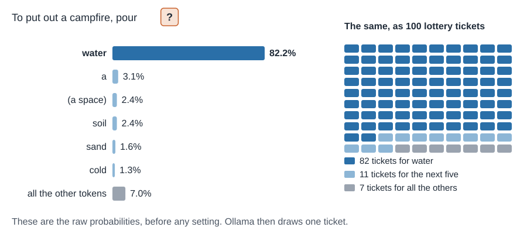
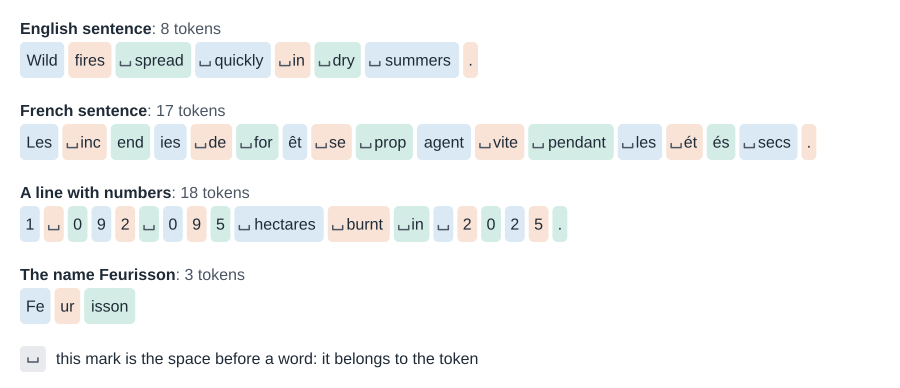
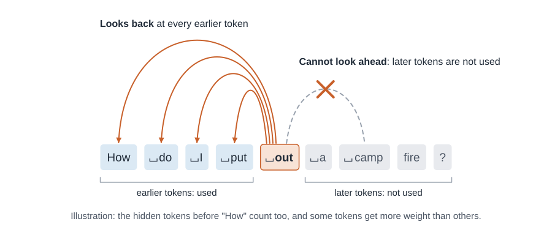
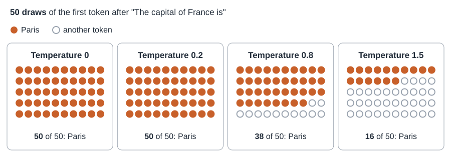

# How a language model works

This page is part of the guide [A chatbot that runs on your own computer](README.md). It is not a
step: you can build your chatbot without it. Read it once, when you have time, to understand what
your chatbot does or to explain it to a group. On a phone, tap a picture to open it, then zoom.

> [!NOTE]
> Every number about the model on this page comes from one model on one computer: `qwen2.5:7b`, with
> Ollama 0.40.8, on a laptop with an NVIDIA RTX PRO 500 Blackwell graphics card (6 GB), measured on
> 1 November 2026. Another model cuts words differently and gives other numbers. Most tests sent
> plain text straight to the model, with no chatbot around it.

## The whole chain

![The whole chain from top to bottom: the question "How do I put out a campfire?" and the hidden text around it are cut into 38 tokens, 9 for the question and 29 hidden; each token becomes 3,584 numbers; 28 layers change them; the last stage gives probabilities for 152,064 tokens; the draw picks one, here the top token "To"; an arrow adds it to the text and repeats for each token of the answer, and only the new token goes through; inside the model, 7.6 billion fixed parameters feed the numbers, the layers and the last stage.](images/llm-overview.svg)

Read the picture from top to bottom. Ollama, the program that runs the model, cuts the text into
*tokens*, small pieces of text. A chatbot adds text you do not see, so the model reads 38 tokens for
a 9-token question ([What is really sent](#what-is-really-sent)). Each token becomes a list of
numbers. The layers of the model change these numbers, and the last stage gives a probability to
every token the model knows. Ollama picks one at random, like a lottery ticket (this pick is the
*draw*), and adds it to the text.

Then the chain runs again for the next token, once for each token of the answer. It gives the same
result as redoing the whole text, but Ollama keeps what it computed for the earlier tokens, so only
the new token goes through the layers.

The parameters are the fixed numbers in a file on your disk: they do this work, and they stay the
same from start to end. That file is the model itself. Ollama works through it, and Open WebUI sends
the text to Ollama.

The next sections open the boxes, starting with the main idea: the next token.
[One question, from start to end](#one-question-from-start-to-end) then follows this example.

## It predicts the next token

A large language model (LLM) does one thing: it predicts the next token, often a short word or part
of a word. Ollama adds the token to the text, and the model predicts again. A whole answer is this
one step, repeated.

Here is one real step. We gave the model the words "To put out a campfire, pour" and read its
probabilities for the next token:



The model gives a probability to every token it knows. The draw works like a lottery in which
likely tokens have more tickets. The 100 tickets of the picture are rounded: in the model, all
152,064 tokens have a share, and the tickets are dealt again for each new token. The numbers here are
the model's raw probabilities, before any setting. A setting called
[temperature](#temperature) changes the draw. At its default value, the top token is drawn more often
than its number here.

Here are two more starts of a sentence (`__` is a blank to fill in):

| Text so far | Most likely next tokens |
|---|---|
| The capital of France is | Paris 54.1%, `__` 6.6%, a 4.9% |
| During a wildfire, the first thing to do is to | stay 11.6%, call 9.3%, get 7.3%, leave 5.0% |

A probability here is about the next token, not about a fact. "Paris" at 54.1% does not mean that the
model is 54% sure of the capital: among the 8 most likely tokens there is no other city, only blanks
and other ways to go on with the sentence. Some texts give one token a high probability, like
"water". Others spread it over many tokens, like the wildfire sentence. An answer does not show
this: a token at 11.6% looks the same on the screen as a token at 82.2%.

A high probability does not mean true. It means that this token often followed such words in the
texts used to build the model. The model has no database and looks nothing up, so it can sound sure
and be wrong. When your chatbot has documents, Open WebUI searches them and adds the passages to the
text (**Function Calling: Legacy**, [part 4](README.md#part-4---build-the-chatbot)). The model still
only predicts the next token.

## What a token really is

A token is a piece of text from the model's fixed list. Think of a box of tiles: each tile carries
one piece of text, this box holds 152,064 different tiles, each usable as often as needed, and every
text must be laid out with them. Unlike real tiles, one can carry a single digit and the next a whole
word. These are real cuts, from the model's
own output:



Short common words are one token. Rare words and names break into pieces, like the name of the
chatbot Feurisson, or a very long English word: `ant|idis|establish|ment|arian|ism` (each `|` marks a
cut). Many everyday words break too in languages other than English, like "forêt" above.

How many characters fit in one token? A high number means that the text takes few tokens. Each row
is one short example, not an average: the same sentence about wildfires in five languages, then two
other texts.

| Text | Characters per token |
|---|---:|
| English | 5.0 |
| French | 3.71 |
| Italian | 3.6 |
| Dutch | 3.27 |
| Catalan | 3.19 |
| A line with numbers | 1.83 |
| Two emoji (each one is a token) | 1 |

Numbers take many tokens because, in this model, each digit is one token, and the space before a
number is another. "2025" alone takes four.

You may read that one token is about 4 characters. That is
[OpenAI's rough estimate for English](https://developers.openai.com/api/docs/concepts), not a rule
for every text.

Tokens matter in three places:

- The *context window* (from now on, the window): everything the model reads and writes must fit in a
  fixed number of tokens ([below](#the-context-window)).
- Speed: the model writes one token at a time. Here, 34.9 tokens per second, with a window of 2048
  and the whole model on the graphics card. So 300 tokens take about 9 seconds of writing, after the
  wait for the first word. This is one short run. We did not measure the speed at 8192, where part
  of the model moves to the processor ([part 4](README.md#part-4---build-the-chatbot)).
- Money: companies that sell a model in the cloud count tokens to set the price. On your own
  computer, there is no cost per question.

## The parts of the model

The text goes through three stages.

1. **Each token becomes a list of numbers**, because a computer can only calculate with numbers.
   This list is called an *embedding*: 3,584 numbers per token here. Think of a place on a map.
   [Workshop 2 of the series](https://github.com/Youth-AI-Lab/yal-workshop-rag) uses the same idea for
   search, with a small separate model that places whole pieces of text. Here, each token gets a
   place inside the language model, and tokens with close meanings tend to sit close. A town needs
   two numbers, a token gets 3,584, and no single number means anything you can read. Unlike a town,
   a token does not stay in its place: the layers move it.
2. **The layers change these numbers.** This model has 28 layers. In each one, every token looks at
   the tokens before it, some more than others, and changes its own numbers, then goes through a
   second calculation of its own. Looking back is *attention*: a
   word takes its meaning from the words before it. Each layer looks back in 28 ways at once
   (28 *attention heads*, a separate figure from the 28 layers).
   [The principle of a Transformer](#the-principle-of-a-transformer) works out one look back by hand.

   Take the token " out". After "put", it means "stop the fire", not "outside": that meaning comes
   from the tokens before it. A token cannot use the tokens after it: the model was trained to
   predict what comes next, so it must not see what comes next.

   

   The layers work like an assembly line. One layer is one section of the line, with two stations:
   looking back, then the second calculation. The numbers go through the 28 layers, one after the
   other. The stations look the same in every layer, but each layer has its own parameters,
   explained below.

   

3. **The last stage gives the probabilities**, one for each of the 152,064 tokens of the model's list.
   Only the numbers of the last token are used for this. It has looked back at everything before it,
   so its numbers depend on the whole text. The bars for water, a and soil above show the top of such
   a list.

This work is done by a huge set of fixed numbers, the *parameters*: the table that gives each token
its first list, the numbers used inside each layer, and those of the last stage. There are
7,615,616,512 here, about 7.6 billion. A token's numbers start from that table, then the layers
change them for this text. These results stay in memory only for the work, and never enter the
parameters.

Think of a panel of 7.6 billion knobs, set at the factory and then left alone. The comparison has two
limits: nobody turns these knobs by hand, and no single knob means anything by itself. Nobody can
point to the knob for "fire" or for honesty. *Training* finds their positions: the model predicts
next tokens on a huge amount of text, and each error changes the parameters a little. The result is
the file on your disk.


Each parameter takes memory, counted in *bits*. At 16 bits each, the file would be 15.2 GB, too large
for our 6 GB card. So each parameter is rounded to fewer bits. This is *quantisation*: each knob gets
fewer marks on its scale, like a long number written with fewer decimals. It takes less room and
loses some detail. The file is 4.68 GB, about 4.9 bits for each parameter. We did not measure what
this rounding costs in quality.

<details>
<summary>How the file gets to 4.9 bits</summary>

Eight bits make a byte, and 16 bits is a common size before this rounding. This file is of the type
Q4_K_M, [mostly 4 bits, with some parts at 6](https://github.com/ggml-org/llama.cpp/pull/1684).
Parameters are stored in small groups that share a scale, so 4 bits really cost about 4.5, and 6
about 6.6. The file is about 37.5 billion bits, for 7.6 billion parameters: about 4.9 bits each.

</details>

Training and running are different things. When the model answers, its parameters do not change, so
it does not learn from your conversations. A chatbot's memory is text sent again: with each new
question, the earlier messages go to the model one more time. If the switch **Memory** of a chatbot
is on, Open WebUI also keeps notes about each participant and sends them again in later
conversations. These notes are text too: the parameters do not change. Open WebUI stores the
conversations on your computer ([the participants' data](README.md#the-participants-data)).

### The principle of a Transformer

The three stages at the start of this section have a name: a **Transformer**. The design comes from a 2017 article,
[Attention Is All You Need](https://arxiv.org/abs/1706.03762): a model built around attention, first
made to translate text. Language models keep the part that writes, which only looks back. Qwen2.5
is a Transformer, like the other models of this guide, and the T of GPT, in ChatGPT, means the same.

The principle fits in one sentence: to find its meaning, each token asks the tokens before it, and
takes the most from those that answer best. Older designs read a text one word at a time and carried
a summary along, so the start of a long text could fade. A Transformer lets a token look straight at
any earlier token, near or far. All the tokens of a text can also be calculated at once, which suits
a graphics card.

In each layer, every token makes three lists of numbers from its own numbers, with the parameters of
that layer:

- its **question**: what it is looking for;
- its **label**: what it shows, to be compared with the questions of other tokens;
- its **contents**: what it gives to the tokens that pick it.

These names are only a picture: nobody chose what the lists hold, training found it. The usual terms
are *query*, *key* and *value*.

Here is the sum by hand, with invented numbers: two numbers per list, and three tokens only. The token
" out" looks at " I", at " put", and at itself: a token counts among the tokens it looks at. Its
question is (2, 1).


1. **Compare.** Multiply the question by each label, number by number, then add. For " put":
   2 × 1 + 1 × 2 = 4. A high score means that the label fits the question.
   [Workshop 2](https://github.com/Youth-AI-Lab/yal-workshop-rag#how-a-text-becomes-numbers) compares
   its lists with the same kind of sum.
2. **Turn the scores into shares.** This is the calculation that gives the probabilities of the next
   token. On a calculator, 2.718 to the power of each score gives 2.7, 54.6 and 7.4, which add up to
   64.7. Divide each one by 64.7: 4.2%, 84.4% and 11.4%.
3. **Mix the contents by these shares.** First number: 0.042 × 0 + 0.844 × 10 + 0.114 × 5, about 9.
   Second number: 0.042 × 10 + 0.844 × 0 + 0.114 × 5, about 1.

The mix (9, 1) is added to the numbers of " out": (1, 3) becomes (10, 4). Most of what it received
comes from " put". With real numbers, this is how " out" ends up meaning "stop the fire".

The rest of the design goes around this sum:

- **Heads.** The three steps run 28 times side by side in each layer, each with its own question, and
  the 28 results are put together. In this model, the 28 heads share 4 sets of labels and contents,
  which saves memory. Nobody chose what each head looks for.
- **Layers.** After the second calculation, the numbers go to the next layer. There, a token looks back
  at numbers that already hold what the layer before gathered, so what " put" gave to " out" can reach
  a later token.
- **Order.** The sum above does not depend on where a token sits in the text: shuffle the tokens and
  the scores stay the same. So the model also uses the position of each token in the text.
- **No looking ahead.** Later tokens get no share at all.
- **What Ollama keeps.** For the earlier tokens, it keeps the labels and contents of each layer. A new
  token only has to ask its question.

<details>
<summary>The formula, if you want it</summary>

The [article](https://arxiv.org/abs/1706.03762) divides each score by the square root of $d$, the
number of numbers in a label, so that long lists do not give huge scores. Our sum by hand leaves this
out, to stay short. With $q$ the question of a token, $k_j$ the label of token $j$, $v_j$ its content,
$s_j$ its score and $a_j$ its share:

$$\displaystyle s_j = \frac{q \cdot k_j}{\sqrt{d}}$$

$$\displaystyle a_j = \frac{e^{s_j}}{\sum_i e^{s_i}}$$

$$\displaystyle \text{mix} = \sum_j a_j v_j$$

The share $a_j$ is the formula of the [temperature](#temperature), with $T = 1$.

</details>

## One question, from start to end

Here is the whole chain with one real question, "How do I put out a campfire?". We turned off the
draw (temperature 0, [explained below](#temperature)): the top token wins at each step.

### What is really sent

In a chatbot, the model never receives the question alone: Open WebUI sends the instructions with it,
and Ollama adds the marks around each message. This is the exact text of our test:

```text
<|im_start|>system
You are Qwen, created by Alibaba Cloud. You are a helpful assistant.<|im_end|>
<|im_start|>user
How do I put out a campfire?<|im_end|>
<|im_start|>assistant
```

The question is 9 tokens. The model received 38: the hidden system message and the role marks add
29. The marks `<|im_start|>` and `<|im_end|>` open and close each message, and the word after
`<|im_start|>` says who speaks. None of this appears on the screen. The text ends just after
`assistant`, so the next token the model predicts is the start of the answer.

In this test, the system message is the model's own default: we gave it no instructions. In your
chatbot, the instructions take this place.

### The cut and the stages

The question is cut like this:

```text
How| do| I| put| out| a| camp|fire|?
```

"campfire" takes two tiles. Then all 38 tokens go through the chain of the first picture. Each one
becomes 3,584 numbers. The 28 layers change these numbers, each token looking only at the tokens
before it, and the parameters do not move. The last stage uses only the numbers of the last token and
gives 152,064 probabilities. The top one becomes the first token of the answer. Then the chain runs
again for the next token: only that token goes through, looking back at what was kept for the tokens
before it.

### The answer, token by token


The first steps had real choices. With a draw, the answer could have started with "Putting" (35.6%).
At step 3, the second best, " extingu" (24.2%), is the first piece of a longer word. After that, the
text leaves little choice: " out" reaches 100% after rounding.

We let the model write 14 tokens. After the 8 of the picture came these 6:

| Step | Chosen token | Second best |
|---|---|---|
| 9 | `follow` 83.7% | `it` 9.1% |
| 10 | `these` 100% | `the` under 0.1% |
| 11 | `steps` 98.9% | `important` 0.8% |
| 12 | `to` 64.0% | a colon and a blank line 35.8% |
| 13 | `ensure` 99.9% | `make` 0.1% |
| 14 | `it` 53.2% | `that` 37.0% |

The whole text reads: "To safely put out a campfire, follow these steps to ensure it".

### Why it stops here

It stops in the middle of a sentence because we asked for 14 tokens and no more (`num_predict`,
[below](#the-others-and-their-defaults)). A complete answer ends on a special end token. We did not
reach one in this test, so we measured nothing about it.

## The context window

The window is the number of tokens the model can hold for one answer: instructions, passages of your
documents, the conversation, and the answer itself. Think of a desk that holds so many pages: all of
this must lie on it at once, including the answer being written. The file of this model allows up to
32,768. Ollama's default is 4096 on our computer, and [part 4](README.md#part-4---build-the-chatbot) sets
**num_ctx (Ollama)** to 8192. Its paragraph **What 8192 leaves** counts what one question takes.

We made a text of 4,122 tokens, our question included, with one code word at its start (TULIP), one
in the middle (OTTER) and one at its end (MAPLE). Then we asked for each one, in a separate test:


The answer gave no error, and the model still answered. We used 2048 only to show the cut. Going by
Ollama's program, your window of 8192 would do the same with a longer text and keep 4,098 tokens. We
did not test that.

Look at the second bar. The text did not fit, so Ollama cut it to 1,026 tokens, about half the
window, and not 2,048. Only the end of the text stayed, with the first 4 tokens of the start. The text
starts "The first code is TULIP": the 4 tokens stop before TULIP, so TULIP was lost too. The cut is
much larger than what did not fit: 2,074 tokens were too many, and 3,096 went. A text of 5,508 tokens
was also cut to 1,026. This is where the desk comparison stops: on a real desk, one page too many
costs one page, and here about half of the desk was cleared.

We read the reason in
[Ollama's program](https://github.com/ollama/ollama/blob/v0.40.8/llm/llama_server.go): when a text
does not fit, it keeps the first 4 tokens and frees about half of the window. In the same program,
the only trace is a warning written to Ollama's log.

We let the model write only 6 tokens, and our text pushed it to finish a sentence. So this test
cannot show whether a model says that something is missing. Asked for TULIP, it began "28, as
mentioned". Asked for OTTER, it wrote "285." Both are wrong.

This test was one long text. In a conversation,
[Ollama's program](https://github.com/ollama/ollama/blob/v0.40.8/server/prompt.go) keeps the
instructions (the *system messages*) and the latest message, and drops the oldest messages first.
If the system messages and the latest message are too long by themselves, the cut of our test still
applies, and the chatbot's instructions can be lost, for example when someone pastes a very long
text. We read this in the program and did not test it.

> [!NOTE]
> On the AI HAT+ 2, the models hold 2,048 tokens and **num_ctx** has no effect on them: leave it on
> **Default** ([step 10](raspberry-pi.md#step-10---build-chatbots-for-the-ai-hat-2-not-tested)). The
> test above ran with Ollama. What happens beyond 2,048 tokens on the HAT is not documented, and we
> did not measure it.

## The settings

Most of these settings change how the draw works. This section is here to understand them, or to
show them to a group. Leave them on **Default**: the scores of
[what we measured](README.md#what-we-measured) used these defaults. Keep the two settings of part 4,
**Function Calling** and **num_ctx (Ollama)**: the row still reads **2 modified** (**1 modified** on
the AI HAT+ 2).

**Temperature**, **Top K**, **Top P** and **Seed** are in the row **Advanced Params** of the chatbot,
as in part 4. Despite its name, this row holds settings that you can move, not the 7.6 billion fixed
parameters of the model.

### Temperature

Temperature decides how strictly the draw follows the probabilities. Think of a dial on the lottery.
When it is low, the top token holds nearly all the tickets and nearly always wins. When it is high,
rarer tokens get more tickets.

Temperature 1 changes nothing: these are the raw probabilities above. Below 1 the gap between tokens
grows, and above 1 it shrinks.

By hand, on two tokens: "Paris" is about 8.2 times as likely as `__` (54.1 divided by 6.6).
Temperature 0.2 multiplies five 8.2s together, because 1 divided by 0.2 is 5: "Paris" becomes about
37,000 times as likely. Temperature 1.5 brings 8.2 down to about 4 (on a calculator: 8.2 ^ (2/3),
because 1 divided by 1.5 is 2/3). Temperature 0 means no draw: the top token every time.

<details>
<summary>The formula, if you want it</summary>

The model first has a raw score for each token. Temperature divides each score, then the scores
become probabilities. This is the [softmax with a temperature](https://arxiv.org/abs/1503.02531),
with $s_i$ the score of token $i$, $T$ the temperature, $p_i$ the probability and $e$ a fixed
number, about 2.718. The sum at the bottom makes all the probabilities add up to 1:

$$\displaystyle p_i = \frac{e^{s_i / T}}{\sum_j e^{s_j / T}}$$

The ratio of two tokens at temperature $T$ is their ratio at temperature 1, to the power $1/T$. This
is where the 5 and the 2/3 above come from.

</details>

We drew the first token after "The capital of France is" 50 times at each temperature. We set
**Top K** to 100 and **Top P** to 1, the two limits [explained below](#the-others-and-their-defaults),
so that they held back only the rarest tokens:



The higher the temperature, the less often the top token wins. This counts first tokens only. The
others were blanks or words that start another sentence, not wrong cities. The most frequent ones:

| Temperature | Other tokens (times drawn) |
|---|---|
| 0.8 | `a` (3), `the` (2), `____` (2) |
| 1.5 | `____` (5), `__` (4), `now` (3), `the` (3) |

With whole sentences, temperature 0 gave the same sentence in 3 tries, each with a different
starting number (a *seed*). At 0.8 and 1.5, the sentence changed.

### The others, and their defaults

| Setting | What it does | Value on **Default**, with Ollama |
|---|---|---|
| **Temperature** | How strict the draw is. | 0.8 |
| **Top K** | The draw uses only the K most likely tokens. | 40 |
| **Top P** | The draw uses the most likely tokens until [their probabilities add up to P](https://arxiv.org/abs/1904.09751). | 0.9 |
| `repeat_penalty` | Makes tokens already used less likely. 1.0 means off. | 1.0 |
| **Seed** | The number the random draw starts from. With the same seed, temperature 0.8 gave the same sentence twice. | not checked |
| `num_predict` | The maximum length, in tokens. At 5, the answer stopped in the middle of a sentence: "Wildfires are dangerous because". | not checked |

`repeat_penalty` and `num_predict` are Ollama's names. You do not need them for your chatbot.

On the AI HAT+ 2, these defaults may not apply: the file of `qwen2:1.5b` from Hailo lists other
values. We did not test them.

**Seed** may show the same draw twice, but not always: try it before a session.

<details>
<summary>How we checked these values</summary>

We checked the four values once, on one question, with a fixed seed. Sending no setting gave exactly
the same text as these four values, and a different text from temperature 0.7 or 1.0, or
`repeat_penalty` 1.1. One earlier check did not match, even with the same values, and we did not
find why.

The [documentation of Ollama](https://docs.ollama.com/modelfile) gives the same four values. An
Ollama Modelfile can also set its own values with `PARAMETER`. The parameter table of that page gives
2048 for `num_ctx`, but the [page on context length](https://docs.ollama.com/context-length) gives
4096 (written 4k) below 24 GiB of graphics memory. Part 4 sets 8192 in place of that 4096.

</details>

Temperature does not make a chatbot truthful. It changes the draw, not what the model knows or what
is in your documents. We did not measure which value gives better answers on documents. If you lower
it, the answers change less from one try to the next. We cannot say that they are more correct: when
the top token is wrong, it comes back every time.

## Check yourself

Cover the first picture and name its six boxes in order. Then say where the parameters are, and what
changes and what does not when the model answers. Last, redo the three steps of attention with the
question (1, 2) in place of (2, 1), keeping one decimal. You should find the scores 2, 5 and 2.5, the
shares 4.4%, 88.3% and 7.3%, and the mix (9.2, 0.8).

## What you can say to a group

> A chatbot writes one small piece of text at a time. Each time, it picks a likely next piece. Likely
> does not mean true, so it can sound sure and still be wrong. The model alone has nothing to look
> things up in. It reads only the text sent with your question. With Ollama, if there is too much
> text, part of it is dropped, sometimes much more than the extra, and the answer gives no warning.
> Our model does not learn from what you type, but your conversation is stored on this computer, and
> if Memory is on, Open WebUI keeps notes about you. Online chatbots can differ: some keep your chats
> to train later models. So never type private things.

For the last point, Google [says](https://support.google.com/gemini/answer/13594961) that it uses
your Gemini activity to train its models, and that human reviewers read a subset of chats. Read the
rules of each service.
